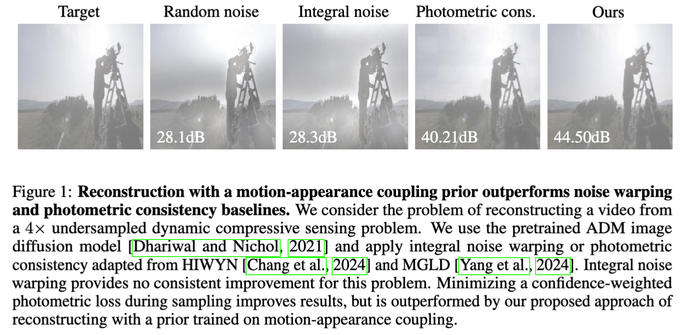

# Learning Motion-Appearance Coupling Priors for Solving Video Inverse Problems

This repository provides code for the paper:

**Learning Motion-Appearance Coupling Priors for Solving Video Inverse Problems**, by Anselm Krainovic and Reinhard Heckel, NeurIPS 2026.

---
*Summary*: Reconstructing video from degraded measurements requires priors that capture both frame appearance and temporal dynamics. Many recent approaches combine pretrained image diffusion priors with motion guidance, sidestepping the costs of training large video models. Temporal consistency is often enforced via photometric losses or warping-based constraints, which implicitly assume that motion explains frame-to-frame or latent-to-latent changes up to small deviations, an assumption that fails under occlusions, lighting changes, and non-rigid deformation.  In this paper, we propose to learn the coupling between motion and frame appearance as a generative prior. We learn the distribution of motion-induced appearance residuals with a conditional diffusion model and use it to regularize reconstruction in video inverse problems. Our motion-appearance prior acts as a plug-in regularizer for diffusion-based video reconstruction, preserving the benefits of image diffusion models while remaining compatible with existing appearance regularization techniques. Experiments on dynamic video inverse problems show that reconstruction with a learnt motion-appearance coupling prior outperforms photometric-consistency and noise-warping baselines, and that the approach also transfers to cardiac MRI reconstruction. 



---

### List of contents

* [Setup and installation](#setup)

* [Datasets and artifacts](#datasets)

* [Running the code](#running)

* [Citation](#citations)
***

<a name="setup"></a>
# Setup and Installation

## Container and package setup

This code was developed and tested with the `pytorch/pytorch:2.1.0-cuda11.8-cudnn8-devel` Docker image. The script `setup/root_setup.sh` can be used to install the required apt-get packages, such as compilers and libraries. Assuming these are installed, the script `setup/user_setup.sh` installs the `nvdiffrast` library required for integral noise warping, and sets up remaining pip environment based on `setup/requirements.txt`. `setup/user_setup.sh` also installs the BART toolbox, used for coil sensitivity estimation for the cardiac MRI experiments, into `libs/bart-0.6.00`, where the code finds it automatically. To use a different BART build, set the `TOOLBOX_PATH` environment variable to its directory. On a multi-node Ray cluster, BART must be installed under the same path on every node. 

## Setup of experiment tracking, storage and workflow orchestration
The experiments in this repository are implemented as `Prefect` flows, where we relied on the Ray backend for parallelized execution of training and reconstruction runs on a cluster. Alternatively, the flows can be applied locally for debugging. Depending on the configuration, the experimental flows spawn a (dynamically created) directed acyclic graph of individual tasks that depend on each other. Here, a task can be downloading the dataset, preprocessing, training the model or performing reconstruction. 

### Backend setup
Results of each task as well as trained models are stored in a MinIO backend, and metrics and figures are logged to Weights & Biases. 
 - (Optional) Set up Weights & Biases and log in with `wandb login` for example.
 - (Required) Set up MinIO and make sure the endpoint URL is reachable.
 - (Optional) Set up a ray server, e.g., by running `ray start --head`.
 - (Required) Set up the Prefect server, e.g., by running `prefect server start`.

### Local configuration
Next, adapt the configuration to these changes by filling in `???` entries of [hydra/config.yaml](hydra/config.yaml):
 - `prefect.api_url`: API URL of the Prefect server, with `http://127.0.0.1:4200/api` for a local `prefect server start`.
 - `minio`: the endpoint URL and credentials of your MinIO server.
 - `wandb`: your project and entity for logging the results, or set `wandb.log=False` to disable it.
 - `data_cache_root`, `data_manual_root` define the data directories (see below)
 - `task_runner`: you can choose `ray` or `local`. `ray_address:null` connects to the cluster started on the same machine.

<a name="datasets"></a>
# Datasets and artifacts

Most pipelines in this repository download required datasets automatically, and store them under a common `data_cache_root` folder that needs to be defined. This folder is also used for subsequent tasks that preprocess the datasets. 
However, some datasets and artifacts need to be added manually, and those need to be stored in subfolders of `data_manual_root`. Both paths must be defined in the `hydra/config.yaml`, with subfolders automatically created by the flows. 

Summarizing:
- `data_cache_root`: Contains all results that are downloaded, generated or processed by steps, which can be removed if necessary and regenerated.
- `data_manual_root`: Some artifacts need to be stored and placed manually, such as the CMRxRecon dataset and the pretrained PDDR checkpoint.

The following artifacts must be placed manually into `data_manual_root`:
 - [CMRxRecon](https://cmrxrecon.github.io/) 2023 and 2024 multi-coil cine data. Registration is required, see `hydra/task/download_dataset/cmrx_recon.yaml` for instructions.
 - [PDDR](https://github.com/MLI-lab/pddr). Place the checkpoint of the pretrained model following `hydra/task/download_dataset/pddr_checkpoint.yaml`.

<a name="running"></a>
# Running the code

Flows are run via [main.py](main.py), which is configured with [Hydra](https://hydra.cc/):
```sh
python main.py +flow=<group>/<flow_name>
```
For example:
```sh
python main.py +flow=main/1_full_method_comparison
```
**Experiment configuration structure**:
 - [hydra/flow/](hydra/flow/): Split into main and appendix, with each flow configuration addressing one major experiment in the paper.
 - [hydra/task/](hydra/task/): Task configurations, which are referenced and partially composed with overrides in the flow configuration files.

**Pipeline**

Experimental pipelines are implemented as Prefect flows. Each task (step in the pipeline) depends on some inputs from previous steps, configuration parameters defined by the `hydra` task generation. Most tasks use caching, and reuse its previously stored outputs instead of rerunning, in case the inputs and configurations to the tasks remain the same. The overall pipeline structure is as follows:
 ```mermaid
 graph LR;
 download-->|raw videos| convert;
 convert-->|video dataset| preprocess;
 preprocess-->|frames + motion estimates| train;
 train-->|coupling prior| tune;
 preprocess-->|test videos| tune;
 tune-->|selected hyperparameters| eval;
 eval-->|results| plot;
 ```

<a name="citations"></a>
# Citation
If you use this repository, please cite the paper:
```bibtex
@inproceedings{cite_key,
    author = {Anselm Krainovic and Reinhard Heckel},
    title = {Learning Motion-Appearance Coupling Priors for Solving Video Inverse Problems},
    booktitle = {Advances in Neural Information Processing Systems},
    year = {2026}
}
```